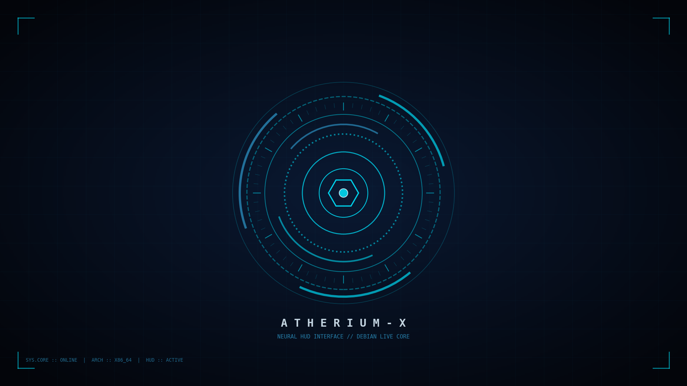

# Atherium-X Live OS

> **A custom, Debian 13 (`trixie`) hybrid BIOS + UEFI live-USB operating system with a futuristic JARVIS-inspired HUD desktop, animated rotating arc-reactor Plymouth boot splash, one-click Wi-Fi, APT, Snap Store, Firefox ESR, native games, and `zram`/`earlyoom` memory management.**

%20amd64-A81D33?style=flat-square&logo=debian&logoColor=white)

-0284c7?style=flat-square)




---

## Download Pre-Built Live ISO

Because GitHub limits individual files to 100 MB, the compiled **651.00 MB** bootable ISO binary is hosted on **Hugging Face**:

- **Hugging Face ISO Repository:** https://huggingface.co/datasets/warrior-kratos13/Atherium-X-ISO/tree/main
- **Direct ISO Download:** https://huggingface.co/datasets/warrior-kratos13/Atherium-X-ISO/resolve/main/atherium-x.iso
- **File:** `atherium-x.iso` (`651.00 MB` / `682,622,976` bytes)
- **SHA256 Checksum ([atherium-x.iso.sha256](atherium-x.iso.sha256)):**
  ```text
  e7d15856716df13957ec61e8ff0f6fb44b8a113d112fab51f63ac2c37f85fe33  atherium-x.iso
  ```

---

## Key Features & Architecture

| Subsystem | Implementation |
|---|---|
| **Base & Kernel** | Debian 13 (`trixie`, `amd64`) via reproducible `live-build 20250814`, stock `linux-image-6.12`, `systemd`, `live-boot` (`overlayfs` + `tmpfs`), auto-login (`user-setup`) |
| **Bootloader & Animation** | Hybrid BIOS (`ISOLINUX`) + UEFI (`GRUB-EFI`) via `xorriso`, custom cyan GRUB/ISOLINUX splash, lightweight script-based **Plymouth** rotating arc-reactor boot sequence (`43.5 KB` sprites) |
| **Hardware Support** | Unpruned laptop firmware (`firmware-iwlwifi`, `firmware-realtek`, `firmware-atheros`, `firmware-brcm80211`, `firmware-sof-signed`), Intel/AMD microcode, Xorg + Mesa 3D, `libinput` touchpad, PipeWire/ALSA, ACPI/brightness, `hwcheck.sh` |
| **Networking** | `NetworkManager`, `wpasupplicant`, `systemd-resolved`, `rfkill`, `lxpolkit` + Polkit rules, `nm-applet` tray + custom one-click GUI Wi-Fi manager (`atherium-wifi`), `nettest.sh` |
| **Package & App Stores** | Runtime-ready `apt` + `aptitude` (`main contrib non-free-firmware`, lists stripped in ISO), `snapd` + AppArmor (`apparmor=1 security=apparmor`) + on-demand **Atherium Store** (`atherium-store`) |
| **JARVIS-Style Desktop HUD** | Lightweight Xorg + **Openbox** + `picom` compositor + rock-solid **LXPanel** Windows-style bottom taskbar + **Rofi** 5-column full-screen translucent app grid + **Conky** live telemetry + **Dunst** startup greeting (`"Welcome back. Atherium-X online."`) + original neon SVG **Atherium-X-Icons** |
| **Apps & Games** | `firefox-esr` (Debian repo), `pcmanfm` (with clickable Desktop shortcuts), `lxterminal`, `mousepad`, `mpv`, `htop`, and 4 native games (`ninvaders`, `moon-buggy`, `bastet`, `2048` — `< 2 MB` total) via `atherium-games` |
| **Memory Management** | `systemd-zram-generator` (`zstd` compressed in-RAM swap), zram-tuned `sysctl` (`vm.swappiness=100`, `vm.page-cluster=0`), and `earlyoom` OOM protection |

---

## Phased Build & Size Progression

Every phase was built reproducibly from source, statically verified (no QEMU/VM), size-audited, and committed to Git:

| Phase | Milestone | ISO Size | SquashFS (`xz`) | Size Report |
|---|---|---:|---:|---|
| **Phase 1** | Minimal bootable CLI core (`systemd`, `live-boot`, hybrid BIOS+UEFI) | 252.00 MB | 186.84 MB | [phase-1.md](docs/size_reports/phase-1.md) |
| **Phase 2** | Dell Vostro hardware drivers, firmware, microcode, Mesa 3D, PipeWire | 456.00 MB | 375.88 MB | [phase-2.md](docs/size_reports/phase-2.md) |
| **Phase 3** | NetworkManager, Wi-Fi/Ethernet, `systemd-resolved`, `nettest.sh` | 538.00 MB | 458.70 MB | [phase-3.md](docs/size_reports/phase-3.md) |
| **Phase 4** | APT + `aptitude` + Debian keyring & runtime sources | 542.00 MB | 462.55 MB | [phase-4.md](docs/size_reports/phase-4.md) |
| **Phase 5** | `snapd`, AppArmor, on-demand **Atherium Store** launcher | 570.00 MB | 490.15 MB | [phase-5.md](docs/size_reports/phase-5.md) |
| **Phase 6** | JARVIS HUD desktop, original SVG icon pack, `168 KB` HUD wallpaper | 607.00 MB | 527.11 MB | [phase-6.md](docs/size_reports/phase-6.md) |
| **Phase 7** | Plymouth rotating arc-reactor animation & GRUB/ISOLINUX branding | 632.00 MB | 539.83 MB | [phase-7.md](docs/size_reports/phase-7.md) |
| **Phase 8** | Firefox ESR, desktop apps, native games, `zram` + `earlyoom` | 762.00 MB | 670.10 MB | [phase-8.md](docs/size_reports/phase-8.md) |
| **Phase 9** | Final optimization: excluded duplicate `/boot/` kernel+initrd from SquashFS (`-77 MB`) + replaced `tint2` with `lxpanel` + Polkit Wi-Fi fix (`-40 MB`) | **651.00 MB** | **558.34 MB** | [phase-9.md](docs/size_reports/phase-9.md) |

---

## Build from Source

### Host Requirements
- **Linux Host:** Debian 12/13 or Ubuntu 22.04/24.04/26.04 (native or **WSL2** on Windows)
- **Disk Space:** ~4 GB free in `/var/tmp/atherium-x-build`
- **Network:** Internet access to `deb.debian.org`
- **Build Time:** ~5–12 minutes (cached rebuilds are faster)

### 1. Install Host Build Dependencies (One-Time)
```bash
sudo bash scripts/setup_host.sh
```

### 2. Build, Verify & Generate Size Report
```bash
sudo make build PHASE=phase-9
```
`make build` stages the sources in `/var/tmp/atherium-x-build` (native ext4 filesystem), runs `lb config && lb build`, copies `atherium-x.iso` to the repo root, generates `atherium-x.iso.sha256`, runs all 6 static integrity checks (`scripts/verify_iso.sh`), and writes `docs/size_reports/phase-9.md`.

### Useful Makefile Targets
| Command | Purpose |
|---|---|
| `sudo make build PHASE=phase-9` | Full reproducible ISO build + SHA256 + static verify + size report |
| `make verify` | Static ISO checks (`xorriso`, BIOS+UEFI El Torito, `unsquashfs -s`, SHA256, size cap) |
| `make size-report PHASE=phase-9` | Generate ISO size + top-20 largest packages report |
| `make checksum` | Regenerate and verify `atherium-x.iso.sha256` |
| `make chart` | Plot `docs/boot_times.png` from real-hardware timings in `docs/boot_times.csv` |
| `make clean` | Clean `/var/tmp/atherium-x-build` and local ISO outputs |

---

## Flash to USB & Boot on Real Hardware

- **Windows (Recommended):** Flash `atherium-x.iso` using **Rufus** in **DD Image mode** (or **balenaEtcher**).
- **Linux / WSL (with USB passthrough):** Use the guarded script (refuses mounted/system/non-removable disks and verifies read-back SHA256):
  ```bash
  sudo bash tools/flash_usb.sh atherium-x.iso
  ```
- **Booting (Dell Vostro):** Restart → tap **`F12`** → choose your USB under **UEFI Boot** (disable Secure Boot in `F2` BIOS Setup if prompted).
- **Built-in Live Diagnostics:** Inside Atherium-X, run `hwcheck.sh`, `nettest.sh`, and `bootlog.sh`.

Full flashing & BIOS guide: [docs/USB_FLASHING.md](docs/USB_FLASHING.md)

---

## Documentation & Deliverables

- **[docs/PACKAGING.md](docs/PACKAGING.md)** — *"How Source Code Becomes an ISO Binary"* (Mermaid pipeline diagram, 8-step explanation, source vs. binary table, 1-slide presentation summary)
- **[docs/HARDWARE.md](docs/HARDWARE.md)** — Dell Vostro driver & firmware justification
- **[docs/SNAP_STORE.md](docs/SNAP_STORE.md)** — Snap Store live-session architecture, squashfs-on-squashfs & AppArmor caveats
- **[docs/APPS_AND_MEMORY.md](docs/APPS_AND_MEMORY.md)** — Browser/apps/games choices & `tmpfs`/`overlayfs` + `zram`/`earlyoom` memory design
- **[docs/TESTING.md](docs/TESTING.md)** — Real-hardware verification checklist
- **[docs/USB_FLASHING.md](docs/USB_FLASHING.md)** — Guarded Linux `dd` + Windows Rufus DD mode + BIOS/Secure Boot guide
- **[docs/boot_times.csv](docs/boot_times.csv)** — Real-hardware boot timing dataset (plotted via `make chart`)
- **[docs/size_reports/](docs/size_reports/)** — Per-phase ISO size & top-20 package breakdowns
- **[CHANGELOG.md](CHANGELOG.md)** — Complete phase-by-phase engineering history
