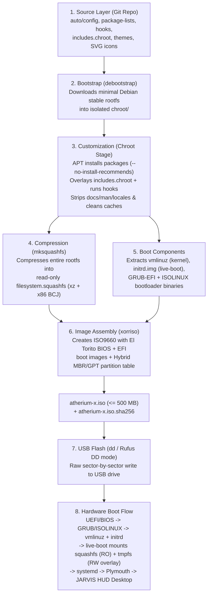

# How Source Code Becomes a Bootable ISO Binary (Atherium-X)

This document explains the end-to-end engineering pipeline that turns plain-text configuration files, shell scripts, and SVG assets in this repository into `atherium-x.iso` — a hybrid BIOS + UEFI bootable live operating system under 500 MB.

---

## End-to-End Build & Boot Pipeline

---

## Step-by-Step Breakdown

### 1. Source Layer (`live-build` Configuration)
Everything that defines Atherium-X lives as human-readable source files in Git:
- **`auto/config`**: Pins the Debian stable release (`trixie`), `amd64` architecture, archive areas (`main contrib non-free-firmware`), `xz` squashfs compression, `--apt-recommends false`, and hybrid `syslinux,grub-efi` bootloaders.
- **`config/package-lists/*.list.chroot`**: Declarative package lists split by phase (core, hardware/firmware, network, APT, snapd, HUD desktop, apps, games).
- **`config/includes.chroot/`**: Files copied directly into the future OS root filesystem (HUD configs, systemd units, SVG icon theme, utility scripts like `hwcheck.sh`, `nettest.sh`, `bootlog.sh`).
- **`config/hooks/normal/*.hook.chroot`**: Scripts executed inside the chroot during build (stripping docs/manpages/non-English locales, configuring Plymouth, zram, earlyoom, recording installed package sizes).
- **`config/bootloaders/`**: Branded GRUB and ISOLINUX boot menu themes.

### 2. Bootstrap (`debootstrap`)
`live-build` invokes `debootstrap` to download and unpack a minimal Debian base filesystem into a temporary `chroot/` directory. At this stage, there is no kernel, no GUI, and no ISO — just a minimal Linux root directory tree (`bin`, `etc`, `usr`, `var`, `lib`).

### 3. Customization (Chroot Stage)
`live-build` enters the `chroot/` using Linux `chroot` (with `/proc`, `/sys`, `/dev` bind-mounted) and:
1. Installs every package listed in `config/package-lists/` with `--no-install-recommends`.
2. Copies all files from `config/includes.chroot/` into the chroot.
3. Runs hooks in `config/hooks/normal/` — enabling services, building the initramfs (including `live-boot` and Plymouth), recording package sizes, and stripping `/usr/share/doc`, `/usr/share/man`, non-English locales, and APT caches to stay under 500 MB.

### 4. Compression (`filesystem.squashfs`)
The entire customized `chroot/` (typically 1.1–1.4 GB uncompressed) is compressed by `mksquashfs` using **XZ compression with the x86 BCJ filter** (`-comp xz -b 1M -Xbcj x86`) into a single read-only compressed filesystem image: `/live/filesystem.squashfs` (~250–400 MB).

### 5. Boot Components
Before the OS can mount `filesystem.squashfs`, the PC firmware needs a kernel and initial RAM disk outside the squashfs:
- **`/live/vmlinuz`**: Debian's stock compressed Linux kernel.
- **`/live/initrd.img`**: Initial RAM filesystem containing `live-boot` scripts, storage/USB drivers, `squashfs` + `overlayfs` kernel modules, and Plymouth boot splash assets.
- **Bootloaders**: `ISOLINUX` (`syslinux`) for Legacy BIOS and `GRUB-EFI` (`bootx64.efi` inside an embedded FAT EFI system partition image `efi.img`) for UEFI.

### 6. Image Assembly (`xorriso` Hybrid ISO)
`xorriso` packages `/live/*` and the bootloader files into a single **ISO9660** image with:
- **El Torito BIOS boot catalog** (points Legacy BIOS to ISOLINUX).
- **El Torito UEFI boot catalog** (points UEFI firmware to `efi.img` -> `\EFI\BOOT\BOOTX64.EFI`).
- **Isohybrid MBR + GPT partition headers** written into the first 32 KB of the ISO (the ISO9660 "System Area").

### 7. Boot Flow on Real Hardware
1. **Firmware (UEFI or Legacy BIOS)** reads the USB's boot sector / EFI partition and starts **GRUB-EFI** (UEFI) or **ISOLINUX** (BIOS).
2. **Bootloader** displays the Atherium-X menu and loads `vmlinuz` + `initrd.img` into RAM.
3. **Kernel + `live-boot` (in `initrd`)** scans attached USB/optical media for `/live/filesystem.squashfs`, mounts it **read-only**, creates a **writable `tmpfs` (RAM disk)**, and merges them with **`overlayfs`** so the OS looks and behaves like a normal read-write Linux filesystem while never modifying the USB stick.
4. **`systemd`** takes over as PID 1, launches **Plymouth** (arc-reactor boot animation), initializes hardware/NetworkManager/zram/earlyoom, and hands off cleanly to the **Atherium-X JARVIS HUD desktop**.

### 8. Why Writing to USB with `dd` / Rufus (DD Mode) Works
A classic optical ISO9660 file has no disk partition table, so writing it raw to a USB drive wouldn't boot. Because `xorriso` builds an **isohybrid** image, the first 512 bytes contain a valid **Master Boot Record (MBR)** and partition table pointing to the ISO data and the embedded FAT EFI System Partition. When `dd` or Rufus (in DD mode) copies the ISO byte-for-byte starting at sector 0 of the USB stick, the USB drive simultaneously presents itself as a valid BIOS-bootable MBR disk and a valid UEFI-bootable EFI partition.

---

## Source vs. Binary Comparison

| Aspect | Source Layer (Git Repo) | Binary Artifact (`atherium-x.iso`) |
|---|---|---|
| **Size** | ~2–5 MB (text configs, scripts, SVGs) | <= 500 MB (compressed binary image) |
| **Format** | Plain text, shell scripts, SVG, Markdown | ISO9660 + Hybrid MBR/GPT + SquashFS (xz) |
| **Editable?** | Yes — version-controlled in Git | Immutable read-only image (rebuilt from source) |
| **Bootable?** | No — blueprint only | Yes — boots directly on BIOS & UEFI hardware |
| **Reproducibility** | Defines exact packages, hooks, and configs | Verified via `atherium-x.iso.sha256` |

---

## 1-Slide Presentation Summary

> **Atherium-X: From Source to Bootable OS**
> - **Blueprint (Git):** Declarative Debian `live-build` configs, package lists, HUD themes, and hooks (~2 MB).
> - **Build (`debootstrap` + `chroot`):** Assembles a clean Debian stable rootfs, installs minimal packages, applies custom JARVIS HUD & Plymouth branding, and strips bloat.
> - **Pack (`mksquashfs` + `xorriso`):** Compresses rootfs with XZ (`filesystem.squashfs`) and bundles stock kernel + `initrd` + BIOS/UEFI bootloaders into a **<= 500 MB hybrid ISO**.
> - **Boot (`overlayfs`):** Flashed raw to USB (`dd`/Rufus); boots read-only SquashFS + RAM `tmpfs` overlay into a live, responsive desktop without touching the host hard drive.
